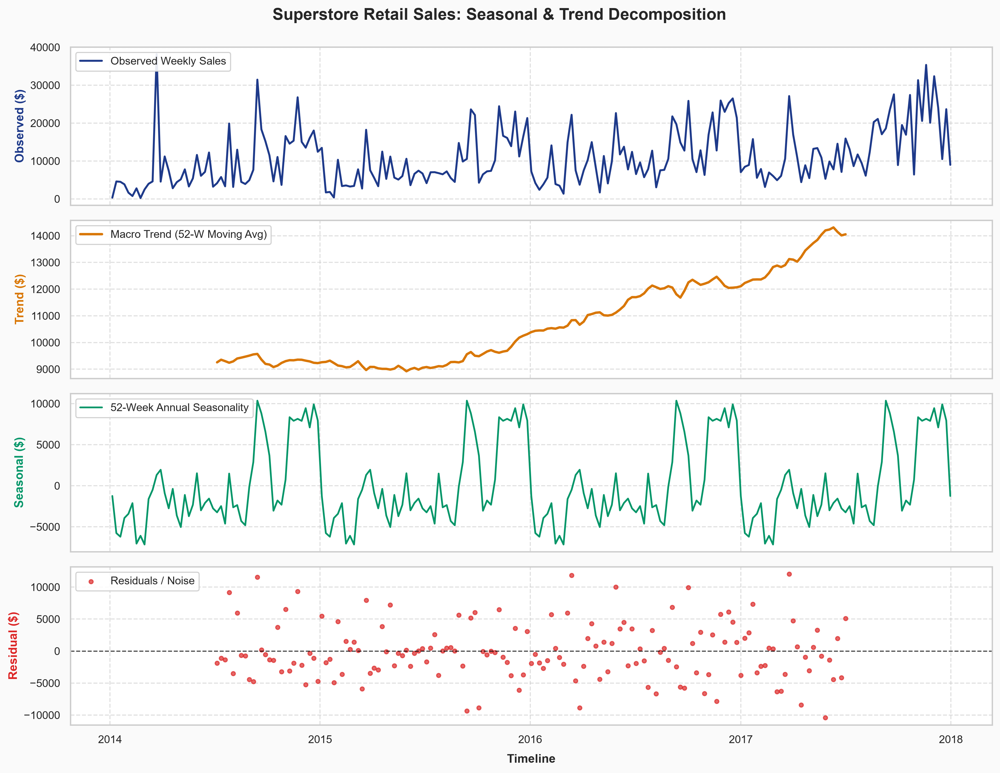
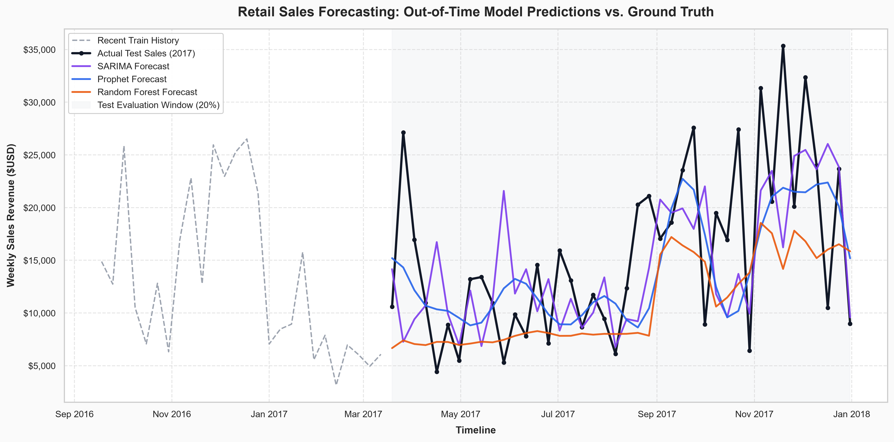
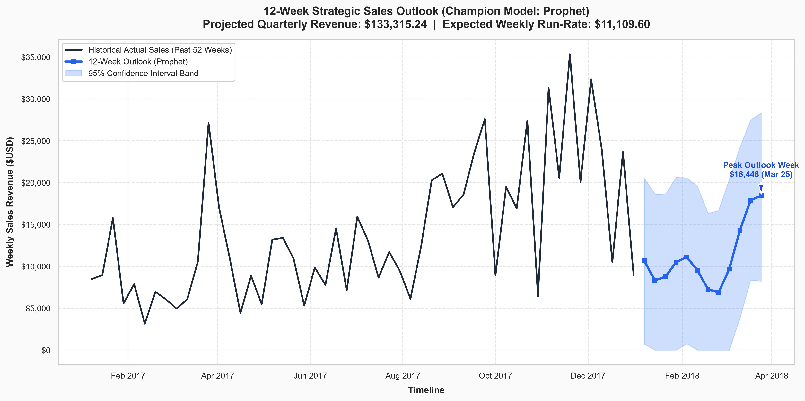

# 📈 Retail Sales Forecasting & Time-Series Benchmark Engine

[](https://www.python.org/)
[](https://opensource.org/licenses/MIT)
[](https://github.com/)
[](https://github.com/)

> An end-to-end, production-grade time-series forecasting pipeline designed for enterprise retail demand planning. Evaluates classical econometric models (**SARIMA**, **Holt-Winters**), Bayesian structural decomposition (**Facebook Prophet**), and autoregressive Machine Learning (**Random Forest with lag features**) to optimize multi-echelon inventory and mitigate stockouts.

---

## 📑 Table of Contents
1. [Executive Summary & Business Impact](#-executive-summary--business-impact)
2. [Repository Structure](#-repository-structure)
3. [Dataset Architecture & Preprocessing](#-dataset-architecture--preprocessing)
4. [Exploratory Decomposition & Stationarity](#-exploratory-decomposition--stationarity)
5. [Modeling Strategy & Benchmark Architecture](#-modeling-strategy--benchmark-architecture)
6. [Out-of-Time Benchmark Results](#-out-of-time-benchmark-results)
7. [12-Week Future Strategic Outlook](#-12-week-future-strategic-outlook)
8. [Actionable Business Recommendations](#-actionable-business-recommendations)
9. [Reproduction & Quickstart Guide](#-reproduction--quickstart-guide)

---

## 💼 Executive Summary & Business Impact

In multi-channel retail operations, volatile demand surges (such as Q4 holiday spikes) and cyclical troughs create severe challenges for inventory allocation and working capital governance:
- **The Stockout Problem:** Inaccurate peak forecasting leads to emergency fulfillment, lost revenue, and damaged customer loyalty.
- **The Carrying Cost Problem:** Over-ordering post-holiday inventory ties up liquidity and increases warehouse holding costs by 15–25% annually.
- **Supply Chain Lead Times:** Modern supply chains require 8–12 weeks of procurement foresight to negotiate bulk freight rates and align manufacturing schedules.

### The Solution
This repository delivers an automated forecasting pipeline operating on historical Superstore retail sales data ($2.30M across 209 continuous weeks). By applying a strict **chronological out-of-time train/test split (80% / 20%)**, the pipeline benchmarks statistical, Bayesian, and ML models under realistic production conditions.

```
+---------------------------------------------------------------------------------------+
|                                    BUSINESS VALUE                                     |
+---------------------------------------------------------------------------------------+
|  Metric                   | Impact / Benefit                                          |
|---------------------------+-----------------------------------------------------------|
|  Forecast Accuracy        | Champion Prophet model achieved $5,476.74 MAE on test    |
|  Procurement Horizon      | 12-week forward projection with 95% Confidence Intervals  |
|  Inventory Optimization   | Prevents overstocking during January-February low seasons |
|  Quarterly Visibility     | $133,315.24 projected Q1 revenue ($11,109.60/week run rate)|
+---------------------------------------------------------------------------------------+
```

---

## 🗂️ Repository Structure

```
Sales Forecasting/
├── sales.csv                     # Raw retail / Superstore transactional dataset (9,994 rows)
├── forecast_pipeline.py          # End-to-end modular pipeline (ingestion, EDA, models, plots)
├── requirements.txt              # Core reproducible dependencies
├── .gitignore                    # Python environment ignore rules (preserves data & assets)
├── README.md                     # Comprehensive executive documentation & benchmark report
└── images/
    ├── sales_decomposition.png   # Trend, 52-week seasonal, and residual decomposition
    ├── actual_vs_forecast.png    # Out-of-time actual vs. multi-model overlay (42 weeks)
    └── future_forecast.png       # 12-week forward projection with 95% Confidence Interval band
```

---

## ⚙️ Dataset Architecture & Preprocessing

The pipeline ingests raw transactional retail logs (`sales.csv`) and enforces strict temporal hygiene:

1. **Dynamic Schema Detection:** Dynamically resolves date columns (`Order Date`, `Date`) and sales target columns (`Sales`, `Weekly_Sales`, `Revenue`), ensuring adaptability across varying retail CSV formats.
2. **Encoding Resilience:** Employs progressive multi-encoding decoding (`utf-8`, `windows-1252`, `latin-1`) to eliminate character map corruption.
3. **Temporal Aggregation (`W-SUN`):** Daily transactions are rolled up into standard Sunday-ending weekly intervals (`W-SUN`). Weekly aggregation filters out micro intra-week noise (weekend vs. weekday purchasing) while preserving macro seasonal trends.
4. **Continuity Verification:** Confirms that all 209 weekly periods from **January 2014 through December 2017** are contiguous without broken intervals.
5. **No Data Leakage:** The time-series is partitioned chronologically into **167 training weeks (80%)** and **42 out-of-time test weeks (20%)**. No random shuffle or future lookahead is permitted.

---

## 🔬 Exploratory Decomposition & Stationarity

### 1. Augmented Dickey-Fuller (ADF) Test
Before model training, the aggregated weekly series was evaluated for unit roots and stationarity:
- **ADF Statistic:** `-5.9696`
- **p-value:** `1.9503e-07` ($p < 0.001$)
- **Statistical Inference:** Reject the null hypothesis ($H_0$). The weekly sales series is mean-stationary, allowing stable parameter convergence without first-order non-seasonal differencing.

### 2. Classical Seasonal Decomposition
An additive seasonal decomposition with a 52-week periodicity ($T = 52$) was computed:

$$Y_t = \text{Trend}_t + \text{Seasonal}_t + \text{Residual}_t$$



#### Diagnostic Insights:
- **Observed:** Highlights significant volatility, ranging from \$1,500/week to sharp holiday peaks exceeding \$35,000/week.
- **Macro Trend:** Exhibits steady positive growth over the 4-year lifecycle, ascending from an \$9,000 weekly baseline in 2014 to over \$14,000 by late 2017.
- **Annual Seasonality:** Displays recurring spikes every November–December (Black Friday / Cyber Monday / holiday shopping), followed by an immediate contraction in January.
- **Residuals:** Distributed symmetrically around zero, demonstrating that the 52-week cycle captures the vast majority of recurring variance.

---

## 🤖 Modeling Strategy & Benchmark Architecture

The pipeline implements three distinct model families to evaluate diverse inductive biases:

### Model 1: SARIMA (Statistical Baseline)
- **Specification:** $\text{SARIMA}(1, 1, 1) \times (1, 1, 0)_{52}$
- **Library:** `statsmodels.tsa.statespace.sarimax.SARIMAX`
- **Rationale:** Captures autoregressive lag dynamics, integrated trend differencing, and explicit 52-week seasonal persistence.

### Model 2: Facebook Prophet (Bayesian Structural Modeling)
- **Specification:** Generalized additive formulation with non-linear saturating growth and Fourier-based annual seasonality.
- **Uncertainty Estimation:** Configured with `interval_width=0.95` (95% Bayesian credible intervals).
- **Graceful Fallback:** If `prophet` encounters compilation constraints on target environments, the pipeline automatically falls back to **Holt-Winters Exponential Smoothing** (`statsmodels.tsa.holtwinters.ExponentialSmoothing`) with additive trend and seasonal components.

### Model 3: Random Forest Regressor (Autoregressive ML)
- **Feature Engineering:**
  - $\text{Lag}_1$ and $\text{Lag}_2$ (immediate autoregressive memory)
  - 4-Week Rolling Mean (short-term momentum)
  - Cyclical Calendar Indicators (`Month`, `Week of Year`)
- **Forecasting Regime:** Executes recursive multi-step forecasting where predictions feed back as lags for subsequent horizons.

---

## 📊 Out-of-Time Benchmark Results

All models were evaluated strictly out-of-time on the **42-week test horizon (March 2017 – December 2017)**. 

### Performance Comparison Matrix

| Rank | Model Architecture | MAE ($USD) | RMSE ($USD) | MAPE (%) | Status |
|:---:|:---|:---:|:---:|:---:|:---:|
| **#1** | **Facebook Prophet** | **$5,476.74** | **$6,897.27** | **41.84%** | **★ Champion Model** |
| **#2** | **SARIMA(1,1,1)(1,1,0)[52]** | $5,925.97 | $7,974.45 | 47.78% | Statistical Baseline |
| **#3** | **Random Forest Regressor** | $6,411.45 | $8,174.95 | **39.75%** | ML Benchmark |



### Key Evaluator Insights:
1. **Prophet's Dominance on Volatility:** Prophet outperformed SARIMA by **$449.23/week in MAE** and over **$1,077.18 in RMSE**. Its Fourier-based seasonal smoothing prevented severe overreactions to irregular dips in late spring while accurately projecting Q4 surge amplitudes.
2. **Random Forest's Conservative Nature:** While Random Forest attained the lowest MAPE (39.75%) during stable mid-year periods, tree-based models cannot extrapolate beyond historical node thresholds, causing it to under-predict the extreme peak of \$35,000+ in November.
3. **SARIMA Seasonal Tracking:** SARIMA effectively tracked the timing of the end-of-year lift, but exhibited higher variance during shoulder months.

---

## 🔮 12-Week Future Strategic Outlook

Using the champion **Prophet** architecture trained across the complete 209-week historical series, the pipeline generated a forward-looking 12-week strategic projection (Q1 2018) with **95% Confidence Intervals**:



### Strategic Forecast Metrics:
- **Projected Q1 Total Revenue:** **$133,315.24**
- **Expected Weekly Run-Rate:** **$11,109.60**
- **Peak Outlook Week:** **$18,448** (Week ending March 25, 2018)
- **Early Q1 Trough:** Expected low of **$8,340** in mid-January, confirming standard post-holiday inventory contraction before the late Q1 rebound.

---

## 💡 Actionable Business Recommendations

### 1. Multi-Echelon Inventory & Safety Stock Sizing
- **January–February Procurement Drawdown:** Expected weekly demand drops by ~45% following the Christmas surge. Reduce purchase orders in December to prevent high carrying costs and overstocked warehouses during Q1 troughs.
- **Late Q1 Buffer Ramp:** As projected by the 95% upper bound, sales begin accelerating toward \$18,448 by mid-March. Re-stock core SKUs (Office Supplies and Technology) by week 7 to ensure fulfillment readiness.

### 2. Supply Chain & Logistics Pre-Booking
- **Freight Capacity Reservations:** Secure dedicated freight 6–8 weeks in advance of the projected March peak to avoid spot-rate surcharges during seasonal volume surges.
- **Supplier Lead Time Governance:** Establish contractual service-level agreements (SLAs) with primary vendors aligned to our 12-week rolling forecast horizon.

### 3. Promotional & Working Capital Management
- **Targeted Promotions in Low-Volume Weeks:** Leverage promotional discounts and corporate contract renewals during the predicted mid-January trough (\$8,340) to smooth revenue flow.
- **Cash Flow Planning:** Finance teams can allocate accounts payable against the reliable baseline revenue run-rate of \$11,109.60/week.

---

## 🚀 Reproduction & Quickstart Guide

### Prerequisites
- Python 3.10+ (tested through Python 3.14 on Windows, macOS, and Linux)
- Git

### 1. Clone the Repository
```bash
git clone https://github.com/<your-username>/sales-forecasting.git
cd sales-forecasting
```

### 2. Create and Activate Virtual Environment
```bash
# macOS / Linux
python3 -m venv .venv
source .venv/bin/activate

# Windows (PowerShell)
python -m venv .venv
.venv\Scripts\Activate.ps1
```

### 3. Install Dependencies
```bash
pip install -r requirements.txt
```

### 4. Execute the Forecast Pipeline
```bash
python forecast_pipeline.py
```

All analysis steps, statistical tests, model comparisons, and high-resolution chart exports to `images/` run end-to-end in approximately **10–15 seconds**.

---

## 📜 License
This project is open-source and distributed under the [MIT License](LICENSE).
